# PassPlate

Software a restaurant runs for itself, shown as the website of one restaurant. Guests book tables against live availability, order at the table from a QR code, to collect or for delivery, follow their order (and their rider on a map) live, and collect rewards. Staff run the room from a live floor plan, the kitchen from its screen, deliveries from a live dispatch map, and drivers from their phones; every payment gets a printable receipt, and admins see every transaction and print the end of day. Built to stay correct during a dinner rush, a dropped Wi-Fi connection or a failed server.

The name is a play on the kitchen pass, the counter where finished plates leave the line.

Full requirements: [REQUIREMENTS.md](REQUIREMENTS.md).

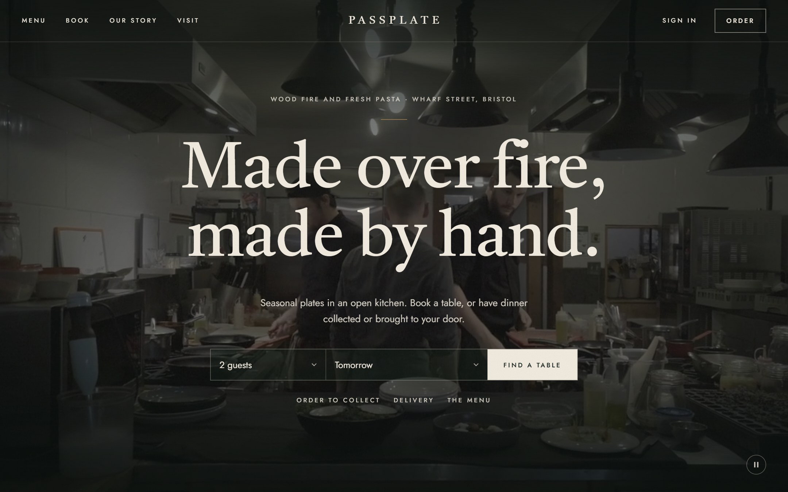

| Menu | Signature plates | At the table |
|---|---|---|
|  |  |  |

| Floor plan | Admin | Delivery tracking | Rewards |
|---|---|---|---|
| 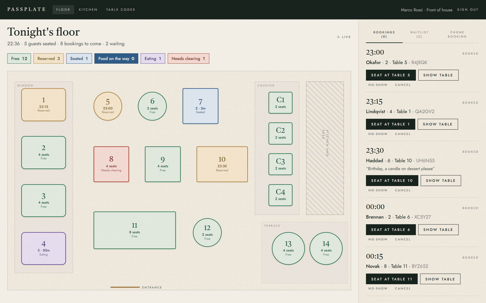 |  |  | 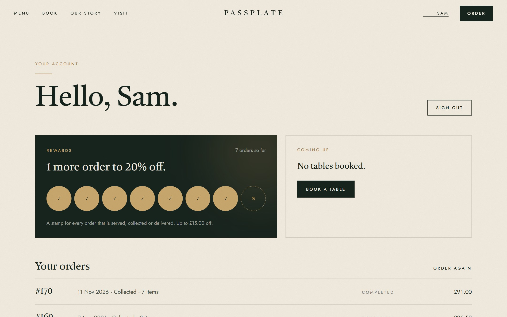 |

| Table ordering | A dish | Live order status | Kitchen display |
|---|---|---|---|
|  |  | 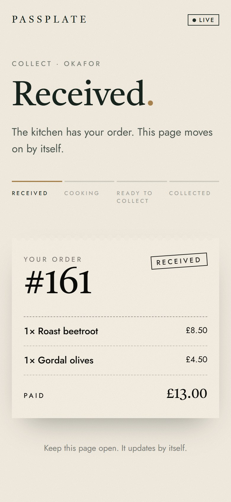 | 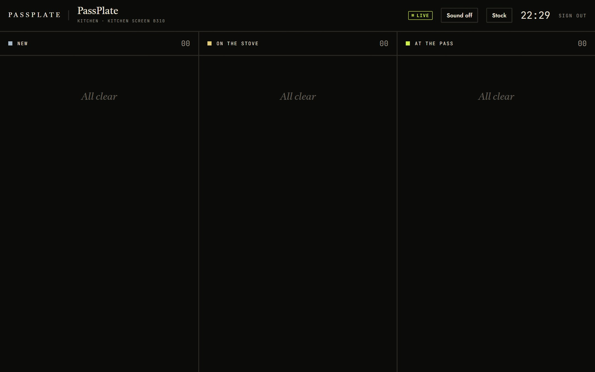 |

| Dispatch map | Giving it to a driver | Proof of delivery | Receipt |
|---|---|---|---|
| 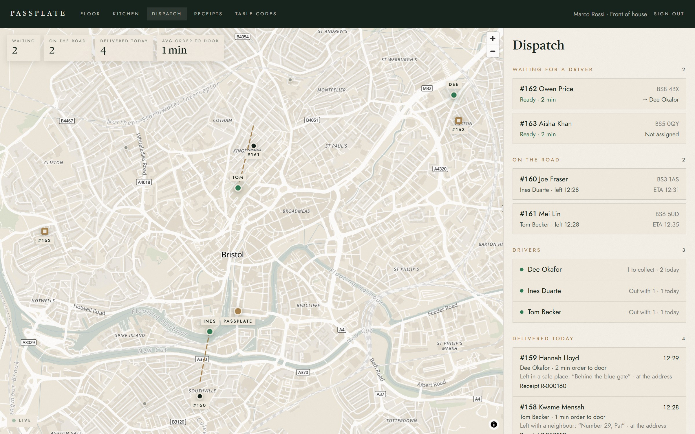 | 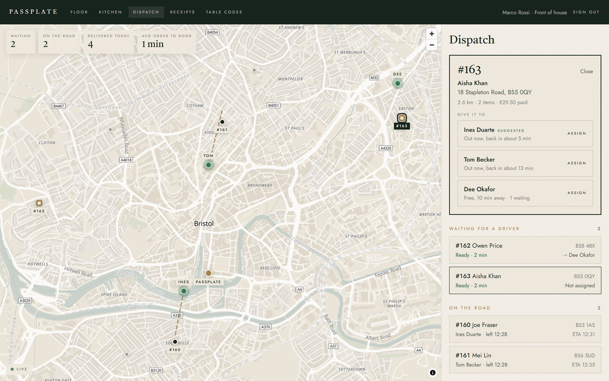 | 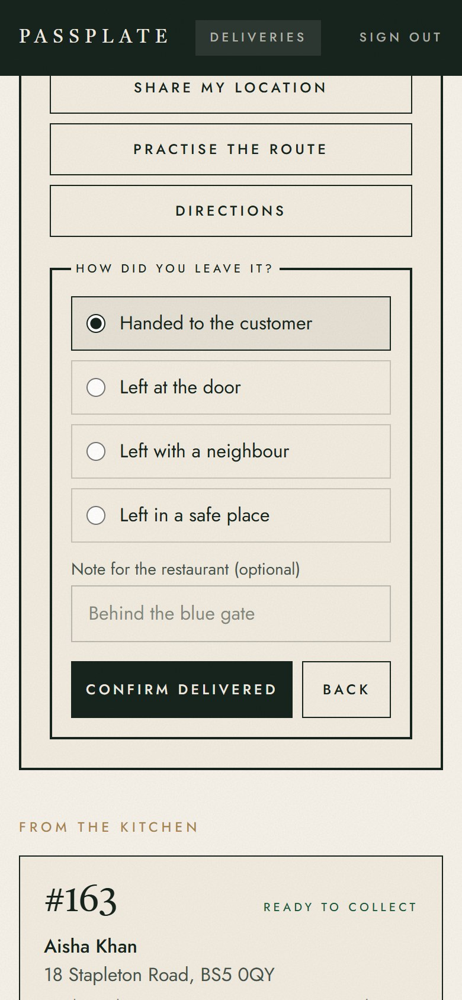 | 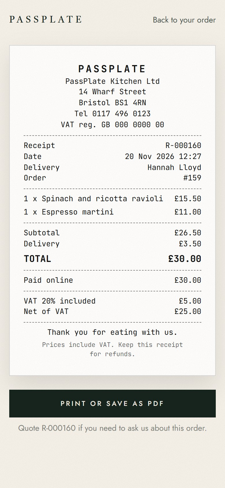 |

| Nearly there | Finding a receipt | End of day | Delivered |
|---|---|---|---|
| 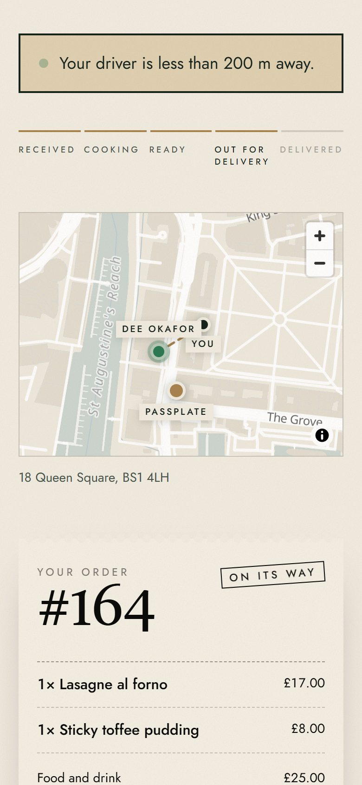 | 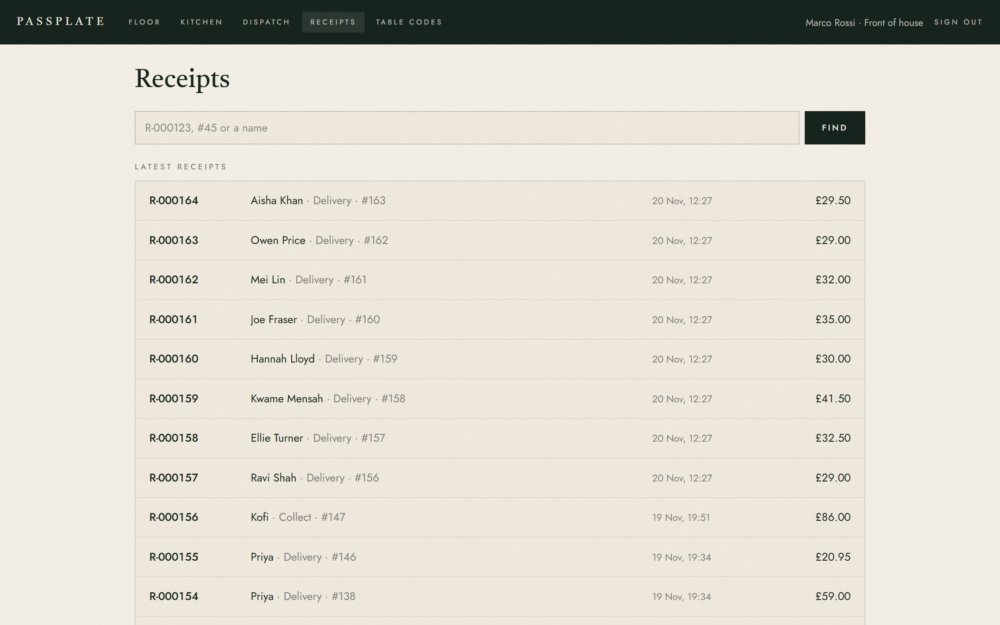 | 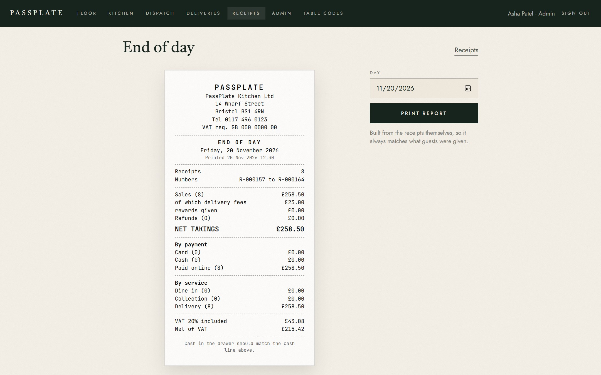 | 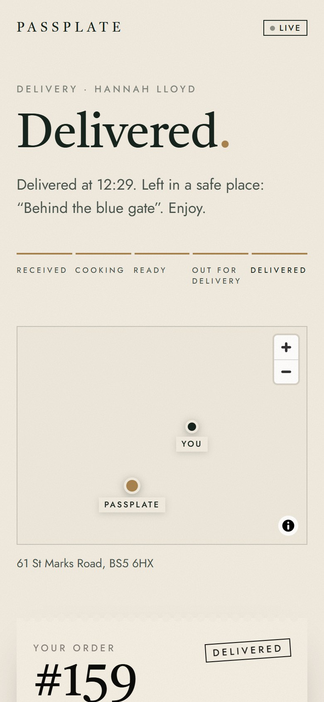 |

| One order for the table | Paying | Menu editor | Editing a dish |
|---|---|---|---|
| 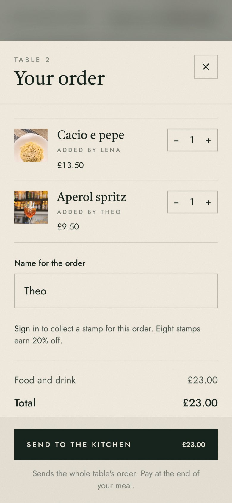 | 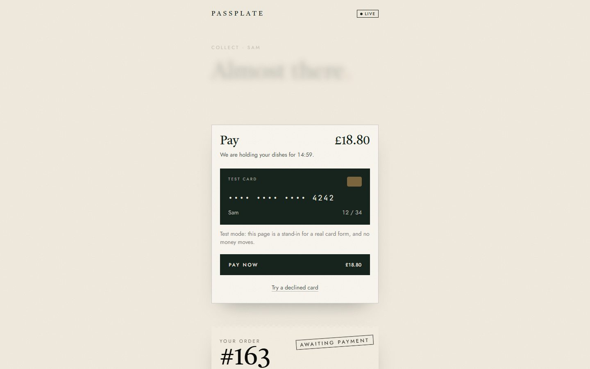 | 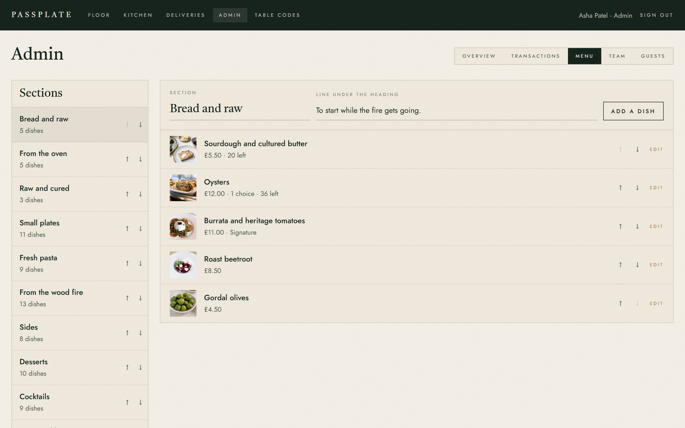 | 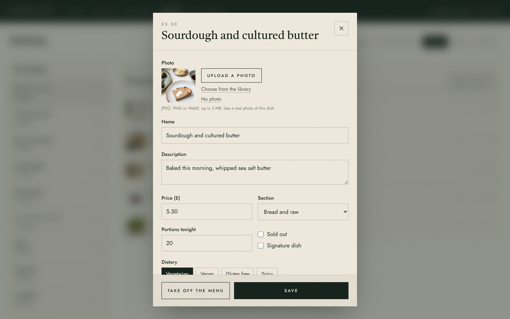 |

## The site

For guests: home (with a booking bar on the first screen), the menu (91 dishes and drinks in twelve sections, each with a real photograph, dietary marks, allergens, filters and search), booking with live availability, our story, visit, an account with rewards, and ordering at the table, to collect or for delivery, with a live status page and a live delivery map.

For staff, behind a sign-in (`/staff`): the floor plan, the kitchen screen, the dispatch map, the driver screen, receipts (find and reprint, end of day), admin (takings, every transaction with refunds and CSV export, the menu editor, the team with invite links, guests) and printable table codes. None of the engineering numbers below appear on the site.

## Accounts, booking, rewards and delivery

- **One account system, four roles.** Customer, front of house (who also run the kitchen screen), driver and admin. Sessions are random tokens in an httpOnly cookie; only their SHA-256 is stored. Passwords are Argon2id. Sign-in is throttled, and a wrong password and an unknown email take the same time and give the same answer. The realtime gateway reads the same cookie, so only staff can watch the kitchen and the floor, drivers the delivery board, and admins the takings. Every kitchen tap is recorded against the person who made it.
- **Invite links (FR-22).** An admin picks a role and gets a link to send. It works once, for seven days, and can be locked to one email; only the SHA-256 of its token is stored. The new person chooses their own password and is signed in.
- **Shared table cart (FR-4).** Everyone who scans a table's QR code adds to one order and sees each other's dishes appear live, with who added what. Each dish added is its own row with an id chosen by the phone, so two phones adding at once never overwrite each other and a retried tap never doubles up. "Send to the kitchen" orders exactly the dishes on that screen, by id: a dessert someone added a second later stays in the cart instead of being sent unseen, and a second phone pressing send on the same dishes is told they have already gone. The other phones are told who sent it, with a link to follow the order. Clearing the table starts the next party on a new cart.
- **Booking.** Fifteen-minute slots inside booking hours; a party holds the smallest table that fits for 90 to 150 minutes. A Postgres exclusion constraint (`btree_gist`, `tstzrange`) makes it impossible to double-book a table, however many people press "book" at once. Availability updates live on every open booking page.
- **The floor.** Staff set two things by hand (seated, needs clearing); everything else is worked out: reserved (a booking within the hour), food on the way (an order in the kitchen), eating (served, bill not settled). Walk-ins, the waitlist, phone bookings, settling by card or cash.
- **Rewards.** Every eighth finished order earns 20% off the next, up to £15. Earned in the same transaction that finishes the order, once (a unique constraint), and spent once.
- **Delivery.** 5 km radius, a fee by distance, £15 minimum. Postcode lookup (postcodes.io) and a map pin choose the address. The driver shares their phone's location every 3 seconds during a delivery only (or practises the route indoors), and the guest watches the rider move with a live arrival time.
- **Dispatch map (FR-14, FR-15).** Front of house and admins see every delivery and every driver on one live map: deliveries waiting (cooking or ready), who is on the road with their route and arrival time, and everything delivered today. Tapping a delivery lists the drivers on shift, best first (back at the restaurant soonest, fewest already waiting on them), and one tap gives it to them; it appears on that driver's phone as theirs, and nobody else can collect it. Drivers start and end shifts from their phone; ending a shift hands back anything not yet collected. Positions only exist during a delivery: between jobs a driver is shown where their last drop-off was.
- **Nearly there and proof of delivery (FR-16, FR-18).** Within 200 m of the door the guest's page says the driver is nearly there (once, with a vibration on phones that allow it). At the door the driver records how the food was left (handed over, at the door, with a neighbour, in a safe place), an optional note, and where the phone was; the dispatch map flags any drop-off more than 150 m from the address, and the guest sees it too.
- **Google Maps with fallback (FR-20, NFR-19 to NFR-21).** Every map is one component with two providers. With `VITE_GOOGLE_MAPS_KEY` set it uses the Google Maps JavaScript API; if Google's script fails, the key is refused or the quota runs out, it switches to MapLibre with OpenFreeMap tiles (open data, no key) on its own, and remembers that for the visit. With `GOOGLE_MAPS_SERVER_KEY` set, the API asks Google's Routes API for the road route once, when the driver sets off, keeps it on the order, and works the arrival time out from it at most every 30 seconds as positions arrive. Each call has a 5 s timeout, retries with jitter and a circuit breaker; any failure falls back to a straight line, so a delivery never waits on Google. Without keys, everything runs on MapLibre and straight lines.
- **Receipts (NFR-22).** Written by the background worker a moment after the money is taken, never inside the request that took it. A whole table settled at once gets one receipt for every round. Numbers (R-000123) are gap-free per restaurant, handed out under an advisory lock, so several workers can never share or skip one. Each receipt is a frozen copy of what was sold (later menu edits never change it), with the restaurant's VAT number and the 20% VAT inside the total. Guests open theirs from the order page and print it or save it as a PDF; staff find any receipt by its number, the order number or the guest's name and print it on an 80 mm till roll, with every reprint marked "Copy"; a refund gets its own receipt pointing back at the sale. The floor offers "Print receipt" right after settling a table. Admins print an end-of-day report built from the receipts themselves: sales, refunds, delivery fees, rewards, takings by payment method and by service, and VAT.
- **Paying before the kitchen sees it (FR-8, FR-10).** Collection and delivery orders are saved as "awaiting payment" with their dishes held, and the guest pays on the next screen. Only a confirmed payment sends the ticket to the kitchen. Unpaid orders expire after 15 minutes, giving their dishes back to the menu and any reward back to the guest. With Stripe keys set, the card form is Stripe's own Payment Element (card details go from the browser to Stripe, never to PassPlate) and Stripe's webhook confirms the payment: signature checked, older than five minutes refused, and each event id recorded in the same transaction as its effect, so a retried webhook does nothing (NFR-13). Only `sk_test_` keys are accepted. Calls to Stripe have a timeout, retries with jitter, an idempotency key and a circuit breaker (NFR-19). Without keys, a built-in test provider stands in, including a "declined card" button. Tables settle with staff. Every payment and refund is its own row; a cancelled paid order is refunded, through Stripe when it was paid there.
- **Menu editor (FR-1).** Admins add and reorder sections and dishes, and change prices, descriptions, photos (upload, or pick from the library), dietary marks, the 14 allergens, portions and choices with their options and prices. Saving reaches every open menu within a second. Options keep their ids when edited, so dishes already in someone's basket still order. Dishes are taken off the menu, never deleted, because past orders name them. Uploaded photos are checked by their bytes (JPEG, PNG or WebP, 3 MB), named by a hash of their content, and cached for a year.

### Development accounts

Test values only, created by `bun run db:seed`:

| Role | Email | Password |
|---|---|---|
| Admin | admin@passplate.test | passplate-admin |
| Front of house | floor@passplate.test | passplate-floor |
| Kitchen screen (front of house) | kitchen@passplate.test | passplate-kitchen |
| Drivers | driver@passplate.test, tom@passplate.test, ines@passplate.test | passplate-driver |
| Guest (seven stamps) | guest@passplate.test | passplate-guest |

The seed also adds two weeks of sample trade, tonight's bookings and a few tables mid-service. `bun run db:seed -- --empty` skips them.

## Simulated user testing

`bun run simulate` (with `bun run dev` running) sends simulated people through the real site in a headless browser, each with their own cookies, tapping and typing: a guest books and cancels a table on her phone; a regular orders, pays, earns and spends a reward; a new guest orders delivery (her first card is declined); a driver starts her shift, the floor manager gives her the delivery on the dispatch map, and she drives it while the guest watches the rider, is told when the driver is nearly there, sees how it was left and opens her receipt; two walk-ins scan the same table's QR code and build one order on two phones, one sends it and the other is told; the floor manager sees it arrive, settles the table, finds the receipt ready to print and resets the table while the admin watches the payment land; the admin changes a price and the guest's open menu updates; a new kitchen hand joins from an invite link and opens the kitchen screen; thirty guests race for the same Saturday table; and a sweep checks every public page on a phone and a desktop. It writes [docs/user-testing/report.md](docs/user-testing/report.md). Last run: 52 of 52 steps passed, no findings. Run `bun run db:seed` afterwards.

## Design

Three colours and nothing else: ivory paper, bottle-green ink and brass. Every other shade is a mix of those three. Castoro (Tiro Typeworks) carries the voice; Jost sets the spaced capitals, menus and buttons. Headings are centred under a short brass rule, there are no italic accent words, and every dish on the menu has a real photograph. The kitchen screen keeps its own dark, high-contrast system for use under kitchen lights.

Texture comes from [Paper Shaders](https://shaders.paper.design) (WebGL): a paper texture behind the menu and story headers, fluted glass over a dish photo in the ordering section, and a slow thermal grain gradient in the footer. Contour lines are drawn as SVG from a seeded height field, and a multiply grain sits over every page. Each shader renders a CSS fallback first, pauses offscreen, and stops for anyone who prefers reduced motion.

The hero is a reel of fourteen real kitchen films that dissolve into one another with a slow drift; only the film on screen and the next one are ever loaded. Dish photos develop into focus as they load. All footage and photography is real, shot between 2019 and 2024 by photographers on [Pexels](https://www.pexels.com) (Pexels license); `scripts/fetch-media.ts` lists every source. The files are not committed: `bun run media` downloads them.

## Status

**Acceptance check (FR-10):** a paid order appears on the kitchen screen in under 1 second, timed from the moment the payment is confirmed.

Measured on a laptop (Windows 11, everything local, `bun run latency 300 10`, 20 November 2026):

| Measure | Result |
|---|---|
| Orders sent and paid | 300, 10 at a time |
| Failures | 0 |
| Payment to kitchen screen | p50 351 ms, **p95 570 ms**, p99 712 ms, max 769 ms |
| Client reconnects with an old `since` | 300 of 300 tickets replayed, in order |

Failure scenarios checked by hand in the browser:

| Scenario | What happened |
|---|---|
| API stopped while the kitchen taps "Ready" | Tap saved on the screen ("1 tap waiting to send"), sent automatically when the API came back, diner page updated |
| Redis stopped during service | Order still saved, kitchen switched to "Polling" with a banner, the new ticket appeared within 5 s, back to "Live" when Redis returned |
| Database reseeded under an open kitchen screen | Old session rejected, screen returned to sign-in |

## Load tests (k6)

`load/orders.js` is the k6 script (TEST-4); `bun scripts/load.ts <scenario>` runs it in Docker. Each virtual guest opens the menu as a phone does (with the ETag it already holds) and orders: nine in ten to collect, paying with the test provider, one in ten at a table. Results are from 20 November 2026, on one laptop (Windows 11, Docker Desktop), with the production shape: six API containers behind a load-balancing edge, PgBouncer, Postgres and Redis, all on Docker's network (`docker compose --profile cluster`), and rate limits off because every virtual guest shares one address.

| Scenario | Orders/s offered | Errors | Order p95 | Payment p95 | Menu p95 |
|---|---|---|---|---|---|
| Design load, 2 minutes | 50 | **0.00%** | 990 ms | 781 ms | 7 ms |
| Soak (10 minutes, not the spec's 2 hours) | 50 | **0.00%** (30,001 orders) | 573 ms | 605 ms | 6 ms |
| Step to 60 | 60 | 0.00% | 4.4 s | 2.7 s | |
| Step to 75 | 75 | 0.00% | 4.2 s | 2.5 s | |
| Step to 90: **breaking point** | 90 | 0.91% | 9.6 s | 5.2 s | |
| Spike to 200 (5x in 60 s, held 2 minutes) | 200 | 41% | timeouts | 7.5 s | 10 ms |

What that says, honestly:

- **The design load holds:** 50 orders a second (each with its payment) for minutes on end with no errors, and the menu comes from cache in single-digit milliseconds.
- **Order placement misses its budget on this machine:** p95 under 1 s against the spec's 400 ms. The median is 145 ms; the tail comes from everything (Postgres, six API copies, PgBouncer, nginx and k6 itself) sharing one laptop's Docker VM. It needs measuring on separate machines before anyone signs it off.
- **The 200 orders/s spike is not met:** this laptop breaks at about 90 orders a second. The services are stateless, so the answer is more API instances and a bigger database, which a laptop cannot show.

What the load tests found and fixed:

1. **The order counter was a hot row.** Every order updated one counter row on the restaurant inside its transaction, so under load every order in the building queued for that row's lock. Order numbers now come from a Postgres sequence per restaurant, which takes no row lock.
2. **pg_notify serialized every commit.** Each order notified the outbox relay inside its transaction, and Postgres commits every notifying transaction under one global lock: 16 orders were found waiting at COMMIT at once. The relay now polls the small index of unpublished events every 20 ms instead.
3. **Date formatters were rebuilt per call.** `Intl.DateTimeFormat` objects are now cached.
4. **The Windows to Docker network bridge** made each database round trip 10 to 12 ms under load (2 ms idle), so the API now runs in Linux containers next to the database for load tests, as it would in production. The `Dockerfile` builds it.

Reproduce:

```bash
RATE_LIMIT=off docker compose --profile cluster up -d --build --scale api=6
bun scripts/load.ts design --cluster          # also: smoke, spike, soak, stress
bun scripts/load.ts rate --cluster --rate 75  # one fixed rate, to find the breaking point
```

Each run reseeds the database first. JSON results land in `load/results/`.

## How it works

```
 Phone (diner)                         Kitchen screen
     │  POST /v1/orders                    ▲  WebSocket: ticket.created
     ▼                                     │
 ┌────────┐  one transaction   ┌──────────┐│
 │  API   │──────────────────▶ │ Postgres ││  replay by seq on reconnect
 │ (Hono) │  order + outbox    │  outbox  │◀────────────┐
 └────────┘                    └──────────┘             │
                                    │ poll, 20 ms       │
                               ┌────▼─────┐  publish ┌──┴──────┐
                               │  Relay   │─────────▶│ Gateway │
                               │ (leader) │  Redis   │  (Bun)  │
                               └──────────┘          └─────────┘
```

- **Transactional outbox (NFR-12).** An order, its stock change and its events commit together. An event is never sent for an order that rolled back.
- **One relay, global sequence.** A Postgres advisory lock elects one relay, which stamps each event with a gap-free `seq` and publishes it. Spare relays wait as hot standbys.
- **Resume, not refetch (NFR-7).** Clients remember the last `seq` they applied. After any disconnect the gateway replays exactly what they missed from the outbox, then switches to live.
- **Stateless gateway (NFR-1, NFR-2).** Any instance serves any client; Redis fans events out. Per-instance connection cap, backpressure limit, message rate limit and a draining shutdown that spreads reconnects (NFR-3, NFR-9, NFR-10).
- **Last portion sold once (FR-6, NFR-11).** Counted items use a conditional `UPDATE ... WHERE stock >= qty`, locked in id order. Unlimited items are never written, so popular dishes do not become hot rows.
- **Idempotent orders and taps (FR-7, FR-13).** Orders carry an `Idempotency-Key`; kitchen taps carry an `actionId` and the expected `from` status. Double taps, retries and offline replays act once.
- **Rate limits (NFR-4, NFR-5).** Token buckets in Redis, shared by every API instance, per address, per signed-in person and across all orders. Over the limit answers 429 with `Retry-After`. Tiers follow the spec's priorities: placing orders and kitchen taps get the most room, admin screens the least. If Redis is down, each instance falls back to its own buckets rather than refusing guests. Behind a load balancer set `TRUST_PROXY=1` so the forwarded address counts.
- **Caching (NFR-17, NFR-18).** The public menu is cached in Redis. The outbox relay clears it whenever it publishes any menu event (stock, sold out, an edit), and records that event's sequence number, so a copy written by a request that raced the change is never served. Responses carry an ETag and `s-maxage`, so a CDN can answer for ten seconds; uploaded photos are cached for a year. `docker compose --profile edge up -d edge` starts an nginx stand-in for the CDN on :8080 (it shows `X-Cache: HIT` or `MISS`).
- **PgBouncer (NFR-14).** The API reaches Postgres through PgBouncer in transaction mode, so thousands of client connections share a few dozen server connections. Prepared statements are off for that path, and the 5 s statement timeout lives on the database so it applies through the pooler too. The relay and gateway connect directly, because they hold sessions (LISTEN, advisory locks).

## Run it

Needs [Bun](https://bun.sh) 1.4+ and Docker Desktop.

```bash
bun install
bun run setup        # Postgres + Redis in Docker, migrations, demo restaurant
bun run dev          # API :4000, gateway :4100, relay, web :3000
```

Open http://localhost:3000. The kitchen screen (`/kitchen/passplate`) signs in with a staff account, such as the kitchen account above.

Online payments use the built-in test provider until Stripe test keys are set: `STRIPE_SECRET_KEY` (`sk_test_...`), `STRIPE_PUBLISHABLE_KEY` (`pk_test_...`) and `STRIPE_WEBHOOK_SECRET` (`whsec_...`), with Stripe's webhook pointed at `/api/v1/webhooks/stripe` (for example with `stripe listen --forward-to localhost:4000/v1/webhooks/stripe`).

Maps use MapLibre and straight-line routes until Google keys are set: `VITE_GOOGLE_MAPS_KEY` (browser key, restricted to your domain, with a daily quota cap), optionally `VITE_GOOGLE_MAP_ID` for a styled map, and `GOOGLE_MAPS_SERVER_KEY` for the Routes API (`GOOGLE_ROUTES_MODE` picks `DRIVE`, the default, `TWO_WHEELER` or `BICYCLE`).

`bun scripts/drivers.ts` is the driver simulator (FR-19): it places paid delivery orders, cooks them on the kitchen account, has the dispatcher give each to the suggested driver, and drives the three demo drivers along their routes with proof at the door. `--deliver 4 --road 2 --assigned 1 --waiting 1 --step 3000` sets how many end in each state and how often a position is sent.

```bash
bun run test         # 80 unit + API integration tests, on Postgres and Redis started by Testcontainers (TEST-2)
bun run latency      # FR-10 acceptance check, needs bun run dev
bun run screenshots  # refreshes docs/screenshots with headless Edge or Chrome, needs bun run dev
bun run typecheck
```

## Layout

| Path | What |
|---|---|
| `apps/api` | Hono HTTP API: menu, orders, table carts, payments, kitchen, staff, admin |
| `apps/gateway` | Bun WebSocket gateway with replay |
| `apps/worker` | Outbox relay, and the receipt writer |
| `apps/web` | TanStack Start app: diner ordering, order status, kitchen display |
| `packages/shared` | Zod schemas, order state machine, opening hours, realtime protocol |
| `packages/db` | Drizzle schema, migrations, seed |
| `scripts/latency.ts` | End-to-end latency and replay check |
| `scripts/drivers.ts` | Driver simulator (FR-19) |
| `load/orders.js`, `scripts/load.ts` | k6 load tests |
| `infra/edge` | nginx stand-in for the CDN and load balancer |
| `Dockerfile` | One image for the API, gateway and relay |

## Still open

- **The spike and the order budget at design load** (see the load tests): met in shape, not in numbers, on one laptop. Needs separate machines.
- **A 2-hour soak** (TEST-4): only a 10-minute soak has run so far.
- **Splitting the bill per person** (the rest of FR-8): the table cart knows who added each dish, which is what a split needs, but settling is still one bill per table.
- **Google Maps has not run with a real key.** The Routes client is tested against a stand-in for Google's API (the right fields asked for, a refused key not retried, the breaker opening), and the browser fallback was checked with a deliberately invalid key, which switched the map to MapLibre by itself. Places Autocomplete for addresses (the rest of FR-20) is not built; postcode lookup does that job.
- **Driver simulator routes** follow Google's road route when there is a key, and a gentle curve otherwise; the spec's 200 simulated drivers have not been run.
- **Several restaurants (multi-tenancy, Milestone 4 of the spec), chaos tests, Lighthouse checks in CI and Playwright** (the simulated users drive a real browser over the DevTools protocol instead).
- **Integration tests use Testcontainers by default;** set `TEST_DATABASE_URL` and `TEST_REDIS_URL` to run them against servers you already have, such as the `pass_test` database in docker compose.
