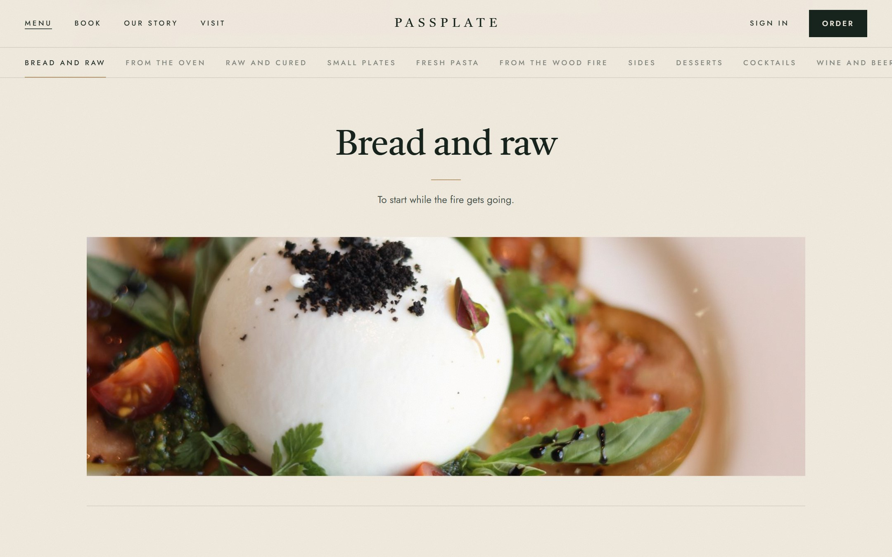
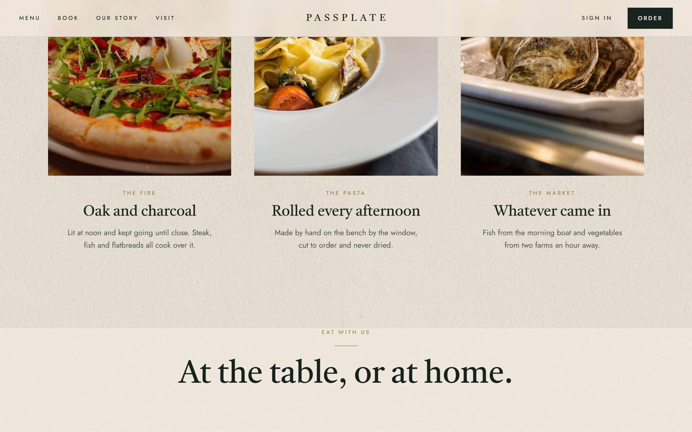
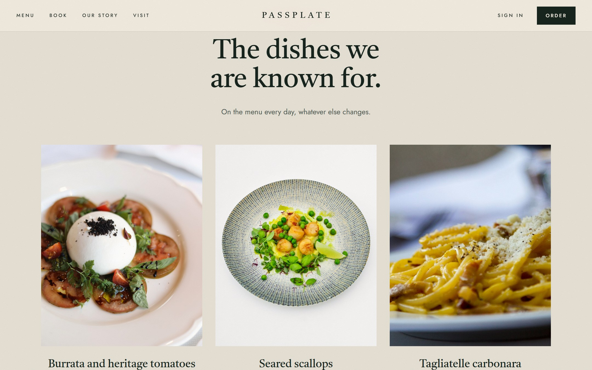
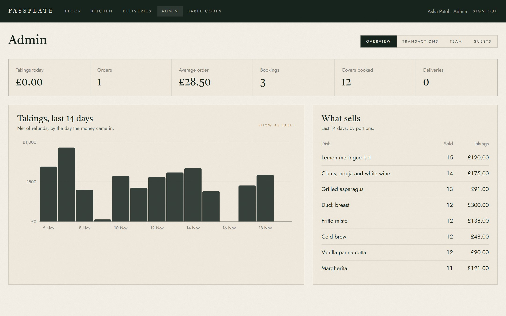
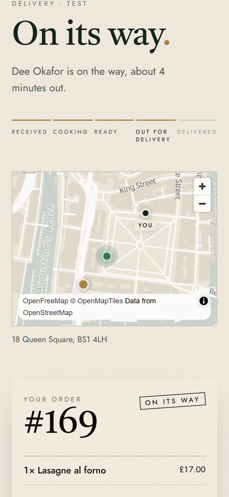
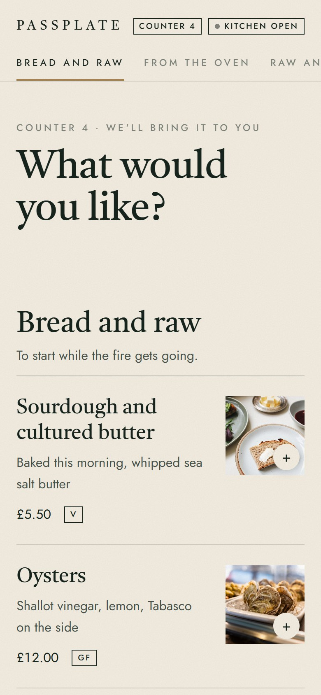
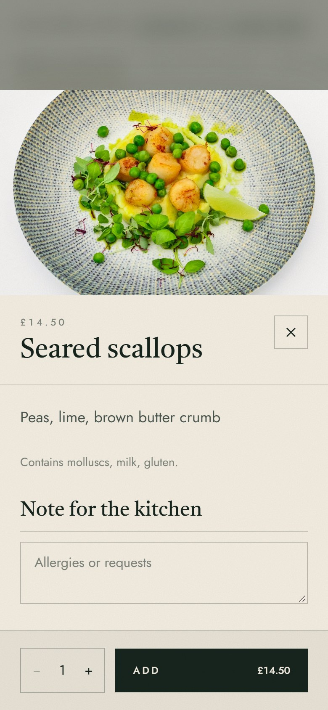

# PassPlate

Software a restaurant runs for itself, shown as the website of one restaurant. Guests book tables against live availability, order at the table from a QR code, to collect or for delivery, follow their order (and their rider on a map) live, and collect rewards. Staff run the room from a live floor plan, the kitchen from its screen, and drivers from theirs; admins see every transaction. Built to stay correct during a dinner rush, a dropped Wi-Fi connection or a failed server.

The name is a play on the kitchen pass, the counter where finished plates leave the line.

Full requirements: [REQUIREMENTS.md](REQUIREMENTS.md).


| Menu | Signature plates | At the table |
|---|---|---|
|  |  |  |

| Floor plan | Admin | Delivery tracking | Rewards |
|---|---|---|---|
|  |  |  |  |

| Table ordering | A dish | Live order status | Kitchen display |
|---|---|---|---|
|  |  |  |  |

## The site

For guests: home (with a booking bar on the first screen), the menu (91 dishes and drinks in twelve sections, each with a real photograph, dietary marks, allergens, filters and search), booking with live availability, our story, visit, an account with rewards, and ordering at the table, to collect or for delivery, with a live status page and a live delivery map.

For staff, behind a sign-in (`/staff`): the floor plan, the kitchen screen, the driver screen, admin (takings, every transaction with refunds and CSV export, the team, guests) and printable table codes. None of the engineering numbers below appear on the site.

## Accounts, booking, rewards and delivery

- **One account system, four roles.** Customer, front of house, driver and admin. Sessions are random tokens in an httpOnly cookie; only their SHA-256 is stored. Passwords are Argon2id. Sign-in is throttled, and a wrong password and an unknown email take the same time and give the same answer. The realtime gateway reads the same cookie, so only staff can watch the floor, drivers the delivery board, and admins the takings.
- **Booking.** Fifteen-minute slots inside booking hours; a party holds the smallest table that fits for 90 to 150 minutes. A Postgres exclusion constraint (`btree_gist`, `tstzrange`) makes it impossible to double-book a table, however many people press "book" at once. Availability updates live on every open booking page.
- **The floor.** Staff set two things by hand (seated, needs clearing); everything else is worked out: reserved (a booking within the hour), food on the way (an order in the kitchen), eating (served, bill not settled). Walk-ins, the waitlist, phone bookings, settling by card or cash.
- **Rewards.** Every eighth finished order earns 20% off the next, up to £15. Earned in the same transaction that finishes the order, once (a unique constraint), and spent once.
- **Delivery.** 5 km radius, a fee by distance, £15 minimum. Postcode lookup (postcodes.io) and a map pin choose the address; MapLibre with OpenFreeMap tiles (open data, no API key) draws the map. The driver shares their phone's location (or practises the route indoors) and the guest watches the rider move.
- **Money.** Collection and delivery are paid when ordering (test mode: no card is charged); tables settle with staff. Every payment and refund is its own row; a cancelled paid order is refunded automatically.

### Development accounts

Test values only, created by `bun run db:seed`:

| Role | Email | Password |
|---|---|---|
| Admin | admin@passplate.test | passplate-admin |
| Front of house | floor@passplate.test | passplate-floor |
| Driver | driver@passplate.test | passplate-driver |
| Guest (seven stamps) | guest@passplate.test | passplate-guest |

The seed also adds two weeks of sample trade, tonight's bookings and a few tables mid-service. `bun run db:seed -- --empty` skips them.

## Simulated user testing

`bun run simulate` (with `bun run dev` running) sends simulated people through the real site in a headless browser, each with their own cookies, tapping and typing: a guest books and cancels a table on her phone; a regular earns and spends a reward; a new guest orders delivery while a driver takes it across town and she watches the rider on her map; a floor manager seats a walk-in, sees their order arrive live, settles and resets the table while the admin watches the payment land; thirty guests race for the same Saturday table; and a sweep checks every public page on a phone and a desktop. It writes [docs/user-testing/report.md](docs/user-testing/report.md). Last run: 33 of 33 steps passed, no findings. Run `bun run db:seed` afterwards.

## Design

Three colours and nothing else: ivory paper, bottle-green ink and brass. Every other shade is a mix of those three. Castoro (Tiro Typeworks) carries the voice; Jost sets the spaced capitals, menus and buttons. Headings are centred under a short brass rule, there are no italic accent words, and every dish on the menu has a real photograph. The kitchen screen keeps its own dark, high-contrast system for use under kitchen lights.

Texture comes from [Paper Shaders](https://shaders.paper.design) (WebGL): a paper texture behind the menu and story headers, fluted glass over a dish photo in the ordering section, and a slow thermal grain gradient in the footer. Contour lines are drawn as SVG from a seeded height field, and a multiply grain sits over every page. Each shader renders a CSS fallback first, pauses offscreen, and stops for anyone who prefers reduced motion.

The hero is a reel of fourteen real kitchen films that dissolve into one another with a slow drift; only the film on screen and the next one are ever loaded. Dish photos develop into focus as they load. All footage and photography is real, shot between 2019 and 2024 by photographers on [Pexels](https://www.pexels.com) (Pexels license); `scripts/fetch-media.ts` lists every source. The files are not committed: `bun run media` downloads them.

## Status: Milestone 2 done (design), Milestone 1 done (menu, ordering, kitchen board)

**Acceptance check:** an order placed on a phone appears on the kitchen screen in under 1 second.

Measured on a laptop (Windows 11, everything local, `bun run latency 300 20`):

| Measure | Result |
|---|---|
| Orders sent | 300, 20 at a time, 108 orders/s |
| Failures | 0 |
| Order to kitchen screen | p50 157 ms, **p95 372 ms**, p99 456 ms, max 668 ms |
| Client reconnects with an old `since` | 300 of 300 tickets replayed, in order |

Failure scenarios checked by hand in the browser:

| Scenario | What happened |
|---|---|
| API stopped while the kitchen taps "Ready" | Tap saved on the screen ("1 tap waiting to send"), sent automatically when the API came back, diner page updated |
| Redis stopped during service | Order still saved, kitchen switched to "Polling" with a banner, the new ticket appeared within 5 s, back to "Live" when Redis returned |
| Database reseeded under an open kitchen screen | Old session rejected, screen returned to sign-in |

## How it works

```
 Phone (diner)                         Kitchen screen
     │  POST /v1/orders                    ▲  WebSocket: ticket.created
     ▼                                     │
 ┌────────┐  one transaction   ┌──────────┐│
 │  API   │──────────────────▶ │ Postgres ││  replay by seq on reconnect
 │ (Hono) │  order + outbox    │  outbox  │◀────────────┐
 └────────┘  + pg_notify       └──────────┘             │
                                    │ notify            │
                               ┌────▼─────┐  publish ┌──┴──────┐
                               │  Relay   │─────────▶│ Gateway │
                               │ (leader) │  Redis   │  (Bun)  │
                               └──────────┘          └─────────┘
```

- **Transactional outbox (NFR-12).** An order, its stock change and its events commit together. An event is never sent for an order that rolled back.
- **One relay, global sequence.** A Postgres advisory lock elects one relay, which stamps each event with a gap-free `seq` and publishes it. Spare relays wait as hot standbys.
- **Resume, not refetch (NFR-7).** Clients remember the last `seq` they applied. After any disconnect the gateway replays exactly what they missed from the outbox, then switches to live.
- **Stateless gateway (NFR-1, NFR-2).** Any instance serves any client; Redis fans events out. Per-instance connection cap, backpressure limit, message rate limit and a draining shutdown that spreads reconnects (NFR-3, NFR-9, NFR-10).
- **Last portion sold once (FR-6, NFR-11).** Counted items use a conditional `UPDATE ... WHERE stock >= qty`, locked in id order. Unlimited items are never written, so popular dishes do not become hot rows.
- **Idempotent orders and taps (FR-7, FR-13).** Orders carry an `Idempotency-Key`; kitchen taps carry an `actionId` and the expected `from` status. Double taps, retries and offline replays act once.

## Run it

Needs [Bun](https://bun.sh) 1.4+ and Docker Desktop.

```bash
bun install
bun run setup        # Postgres + Redis in Docker, migrations, demo restaurant
bun run dev          # API :4000, gateway :4100, relay, web :3000
```

Open http://localhost:3000. The start page has a QR code for a table (phone on the same Wi-Fi), the pickup link, and the kitchen display. Kitchen device code in development: `demo-kitchen`.

```bash
bun run test         # unit + API integration tests (uses the pass_test database)
bun run latency      # Milestone 1 acceptance check, needs bun run dev
bun run screenshots  # refreshes docs/screenshots with headless Edge or Chrome, needs bun run dev
bun run typecheck
```

## Layout

| Path | What |
|---|---|
| `apps/api` | Hono HTTP API: menu, orders, kitchen |
| `apps/gateway` | Bun WebSocket gateway with replay |
| `apps/worker` | Outbox relay |
| `apps/web` | TanStack Start app: diner ordering, order status, kitchen display |
| `packages/shared` | Zod schemas, order state machine, opening hours, realtime protocol |
| `packages/db` | Drizzle schema, migrations, seed |
| `scripts/latency.ts` | End-to-end latency and replay check |

## Not in Milestone 1 yet

Deliberate gaps, each scheduled in a later milestone:

- **Shared live table cart (FR-4):** each phone has its own cart for now. Milestone 2.
- **Menu editor (FR-1):** the menu is seeded; the kitchen can already change stock and mark items sold out. The editor comes with manager accounts in Milestone 4.
- **Payments (FR-8):** orders go to the kitchen when placed. Stripe test mode arrives in Milestone 4, and tickets will then appear after payment confirmation.
- **Staff accounts (FR-22, SEC-2):** a per-restaurant kitchen device code stands in for Better Auth until Milestone 4.
- **Integration tests use a dedicated `pass_test` database** in the Docker Postgres rather than Testcontainers (TEST-2).
- **Rate limiting on HTTP, PgBouncer, CDN caching and k6 load tests** are Milestone 5. The gateway already rate-limits socket messages.
