# Simulated user testing

Run on 2026-11-20 12:27 UTC against http://localhost:3000, in 280 seconds.
Every person below is simulated: a script in a real (headless) browser, with their own cookies, tapping the screen and typing.

**52 of 52 steps passed. 0 findings.**

## Journeys

| Who | Step | Result | Time |
|---|---|---|---|
| Maya | opens the home page on her phone | Passed | 5.2 s |
| Maya | picks 4 guests in the booking bar and taps Find a table | Passed | 1.2 s |
| Maya | finds a free time | Passed | 2.2 s |
| Maya | fills in her details | Passed | 0.8 s |
| Maya | confirms the booking | Passed | 0.6 s |
| Maya | cancels the booking | Passed | 1.2 s |
| Sam | signs in | Passed | 3.9 s |
| Sam | sees 7 of 8 stamps | Passed | 0.6 s |
| Sam | orders a Margherita to collect and pays | Passed | 12.4 s |
| Sam | the kitchen cooks it and he collects it | Passed | 2.4 s |
| Sam | the eighth stamp turns into a reward | Passed | 0.0 s |
| Sam | spends the reward on the next order | Passed | 18.6 s |
| Priya | creates an account | Passed | 9.7 s |
| Priya | switches to delivery and fills a basket | Passed | 6.7 s |
| Priya | finds her address by postcode | Passed | 1.0 s |
| Priya | pays: her first card is declined, the second goes through | Passed | 2.6 s |
| Dee | signs in on the driver screen and starts her shift | Passed | 4.9 s |
| Marco (dispatch) | opens the dispatch map and gives Priya's order to Dee | Passed | 4.8 s |
| Dee | sees it given to her, live | Passed | 0.0 s |
| Priya | the kitchen cooks it | Passed | 1.4 s |
| Dee | sees it ready and sets off | Passed | 0.5 s |
| Dee | drives the route | Passed | 0.6 s |
| Priya | watches the rider move on her map, with an arrival time | Passed | 8.1 s |
| Marco (dispatch) | sees Dee moving on the dispatch map | Passed | 0.0 s |
| Priya | is told the rider is nearly there (within 200 m) | Passed | 0.0 s |
| Dee | leaves it at the door and says so | Passed | 2.2 s |
| Priya | sees it delivered, with how it was left | Passed | 0.0 s |
| Priya | opens her receipt | Passed | 0.6 s |
| Marco (dispatch) | sees it under Delivered today, with the proof | Passed | 0.0 s |
| Marco | signs in and opens the floor | Passed | 4.3 s |
| Asha | signs in and opens transactions | Passed | 4.8 s |
| Marco | seats two walk-ins at Table 2 | Passed | 1.1 s |
| Lena | scans the QR code at Table 2 and gives her name | Passed | 3.7 s |
| Theo | scans the QR code at Table 2 and gives his name | Passed | 4.3 s |
| Lena | adds Cacio e pepe | Passed | 1.8 s |
| Theo | adds an Aperol spritz | Passed | 1.7 s |
| Theo | sees Lena's dish in the table's order, live | Passed | 0.6 s |
| Theo | sends the whole table's order to the kitchen | Passed | 1.0 s |
| Lena | is told Theo sent it, without reloading | Passed | 0.0 s |
| Marco | sees the guests' QR order arrive without reloading | Passed | 0.0 s |
| Marco | the kitchen serves it; the table shows Eating | Passed | 1.8 s |
| Marco | settles the bill by card | Passed | 1.2 s |
| Asha | sees Marco's card payment appear live | Passed | 0.0 s |
| Asha | opens the overview: takings, two weeks of trade, best sellers | Passed | 1.1 s |
| Asha | raises the Tiramisu price in the menu editor | Passed | 3.5 s |
| Lena | sees the new price on her open menu, without reloading | Passed | 0.1 s |
| Asha | makes an invite link for a new kitchen hand | Passed | 1.6 s |
| Jo | opens the invite, chooses a password and is signed in | Passed | 3.9 s |
| Jo | opens the kitchen screen with that account | Passed | 2.2 s |
| Marco | the guests ask for a receipt: it is ready to print | Passed | 0.4 s |
| Marco | resets the table | Passed | 0.6 s |
| Crowd | 30 guests book Saturday 2026-11-28 at 20:00 for four at the same moment | Passed | 4.8 s |

- Crowd: 10 booked, each on a different table (Table 1, Table 13, Table 3, Table 7, Table 8, Table 10, Table 9, Table 4, Table 2, Table 14); 20 were told it had just been taken; 20:00 now shows as full.

## Findings

None.

## Slow first loads

- /r/passplate took 6.6 s to become interactive for Sam
- /account took 6.5 s to become interactive for Priya

These are measured against the development server, which compiles code on first request. A production build loads in one go.

## Page sweep

| Page | Device | Sideways scroll | Broken pictures | Console errors | Unnamed controls | Small tap targets |
|---|---|---|---|---|---|---|
| / | Phone | None | 0 | 0 | 0 | 0 |
| /menu | Phone | None | 0 | 0 | 0 | 0 |
| /book | Phone | None | 0 | 0 | 0 | 0 |
| /story | Phone | None | 0 | 0 | 0 | 0 |
| /visit | Phone | None | 0 | 0 | 0 | 0 |
| /account | Phone | None | 0 | 0 | 0 | 0 |
| /r/passplate | Phone | None | 0 | 0 | 0 | 0 |
| /r/passplate?delivery=1 | Phone | None | 0 | 0 | 0 | 0 |
| / | Desktop | None | 0 | 0 | 0 | n/a |
| /menu | Desktop | None | 0 | 0 | 0 | n/a |
| /book | Desktop | None | 0 | 0 | 0 | n/a |
| /story | Desktop | None | 0 | 0 | 0 | n/a |
| /visit | Desktop | None | 0 | 0 | 0 | n/a |
| /account | Desktop | None | 0 | 0 | 0 | n/a |
| /r/passplate | Desktop | None | 0 | 0 | 0 | n/a |
| /r/passplate?delivery=1 | Desktop | None | 0 | 0 | 0 | n/a |

## Screens

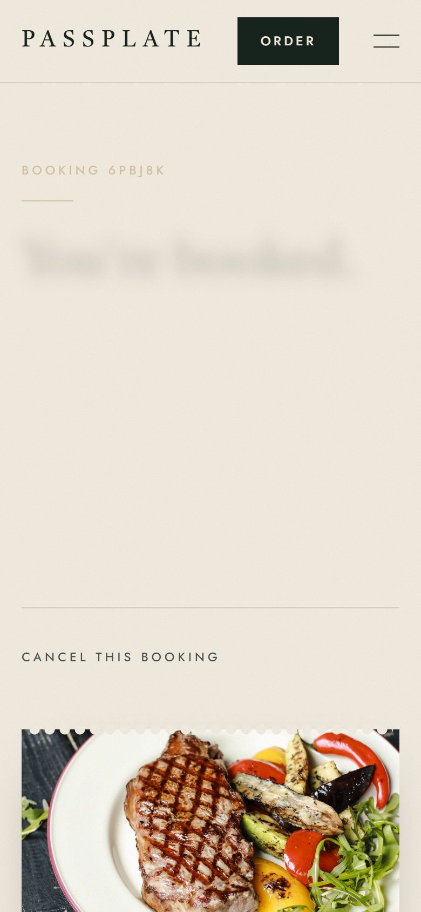
*Maya: Maya's confirmation, with her reference*

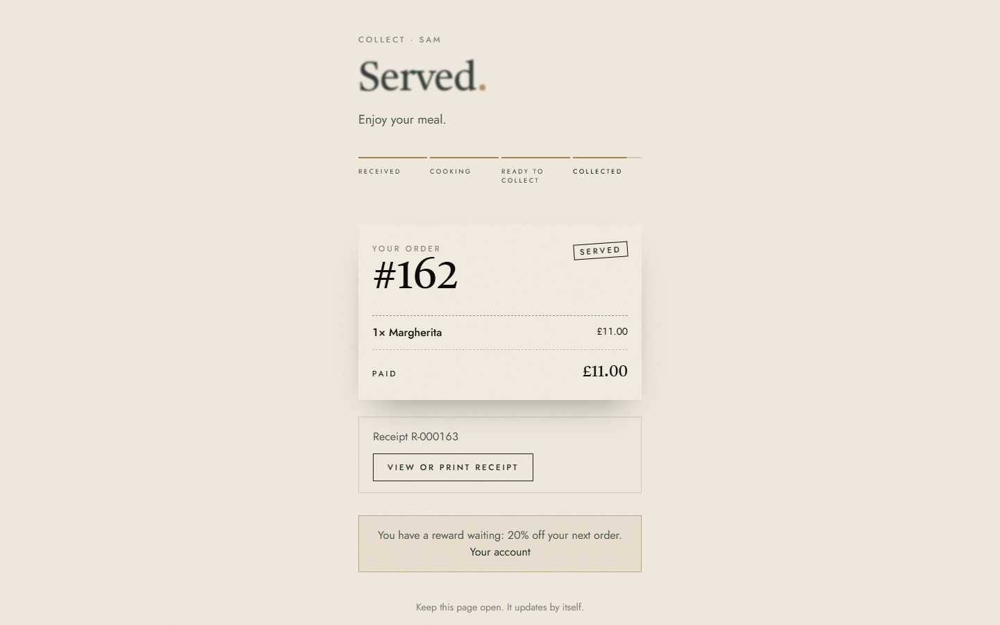
*Sam: Sam's eighth order: the reward appears on the order page*

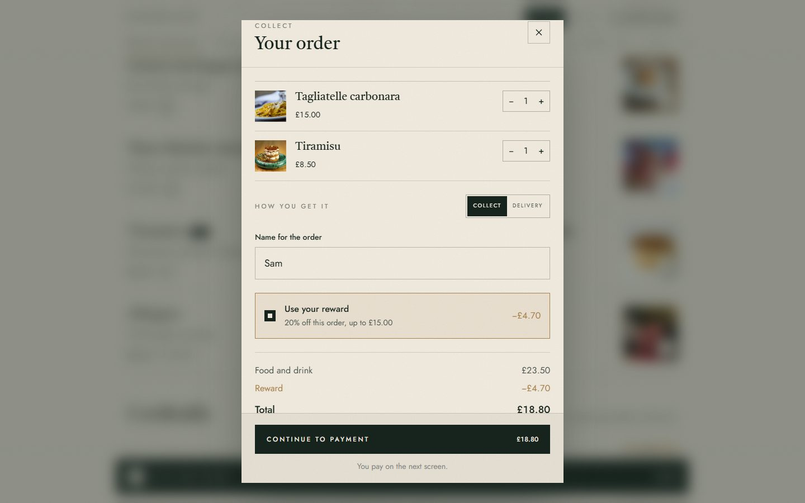
*Sam: Sam's basket with 20% off*

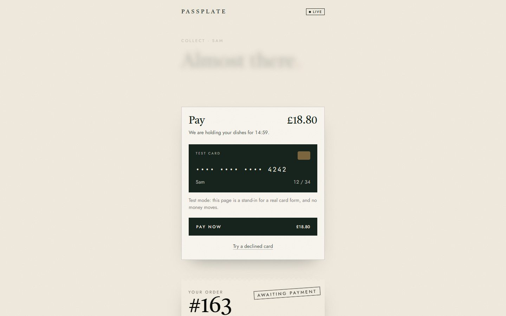
*Sam: Sam's payment step: the kitchen gets the order once it is paid*

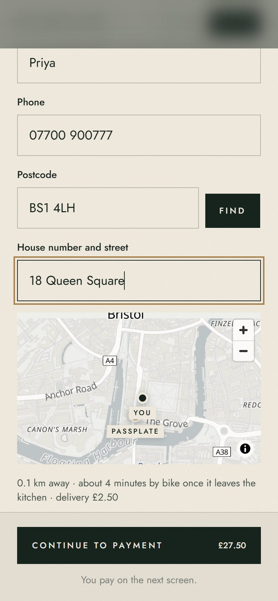
*Priya: Priya's delivery checkout: address, fee and total*

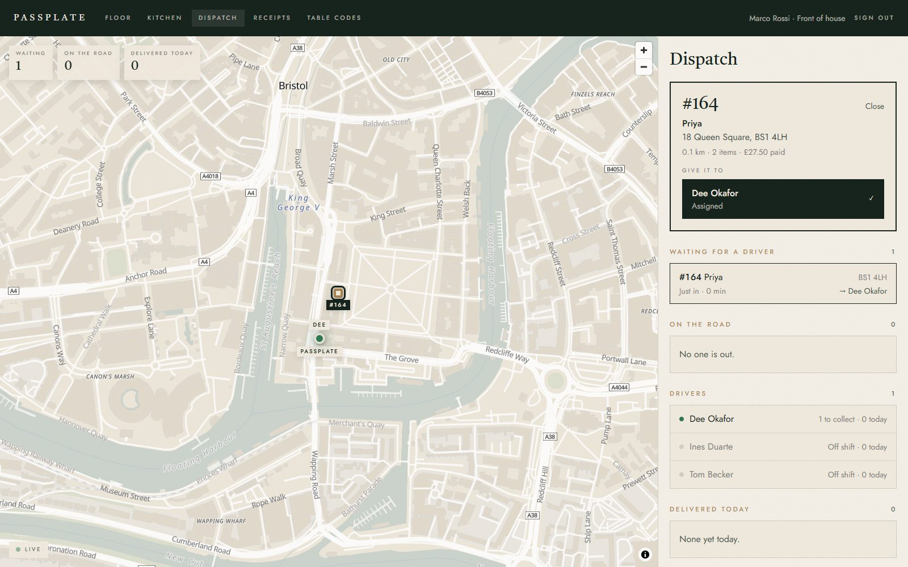
*Marco (dispatch): Marco's dispatch map: Priya's order given to Dee*

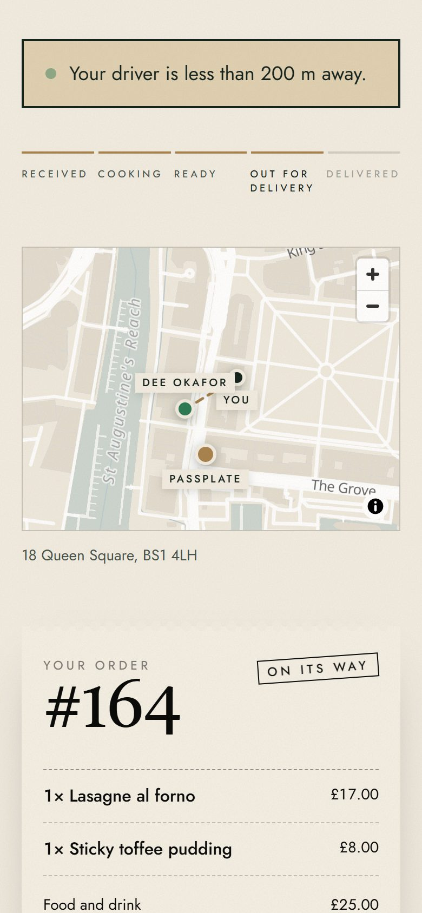
*Priya: Priya's order page: the rider moving towards her*

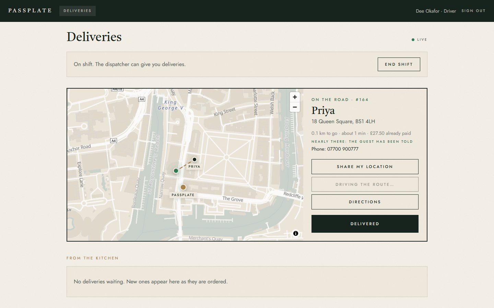
*Dee: Dee's driver screen during the delivery*

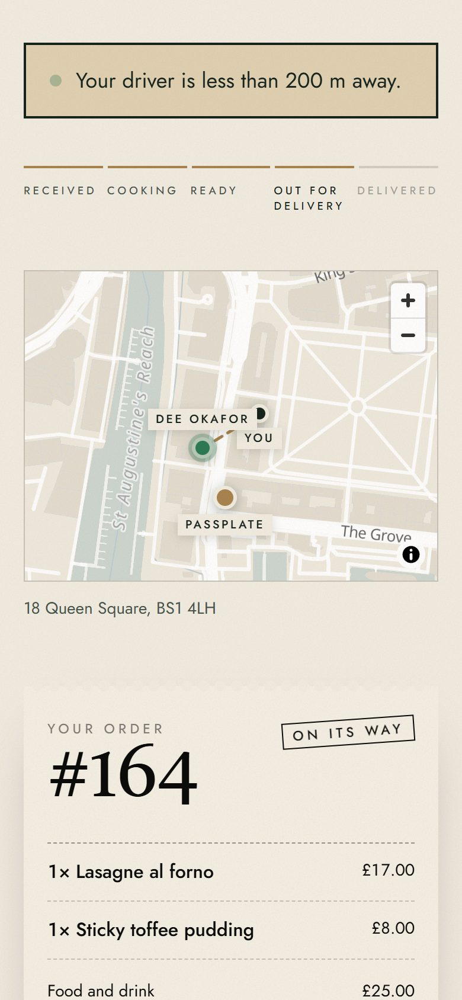
*Priya: Priya's order page: the driver is nearly there*

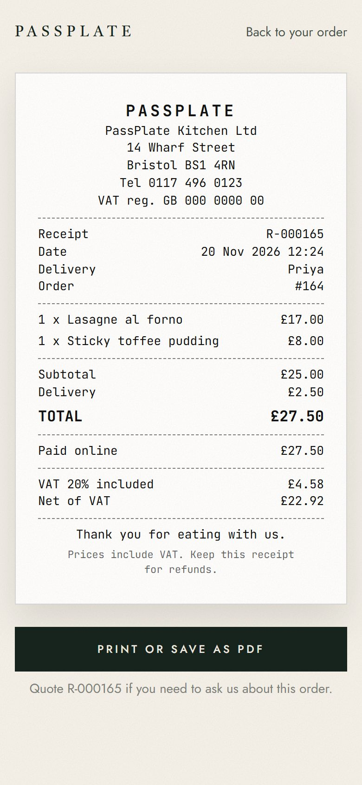
*Priya: Priya's receipt, ready to print or save as a PDF*

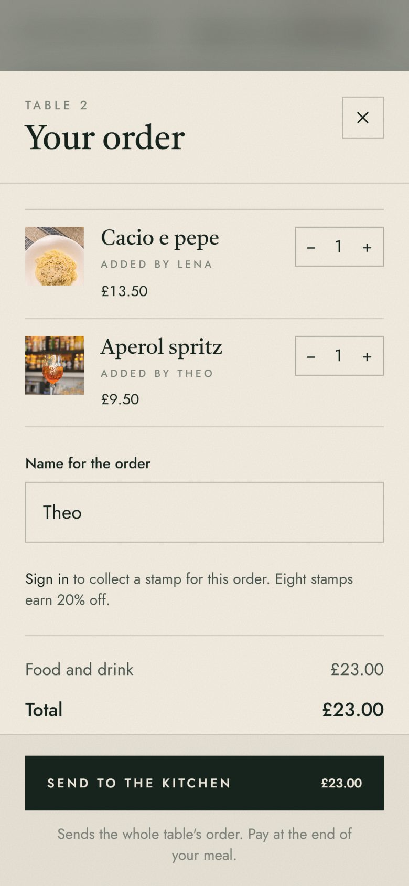
*Theo: Theo's phone: one order for the table, with who added what*

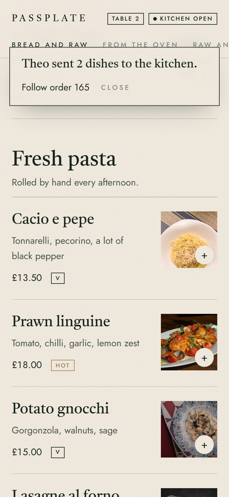
*Lena: Lena's phone: Theo sent the table's order*

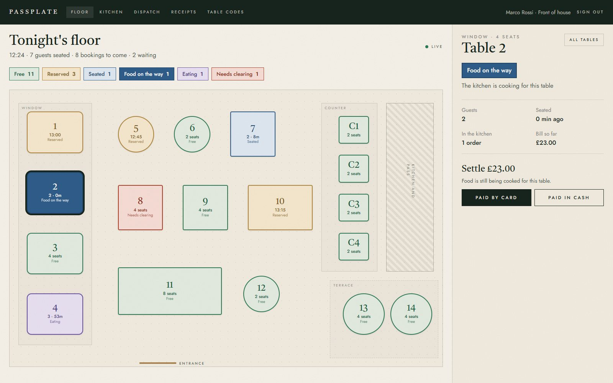
*Marco: Marco's floor: the walk-in's order shows live*

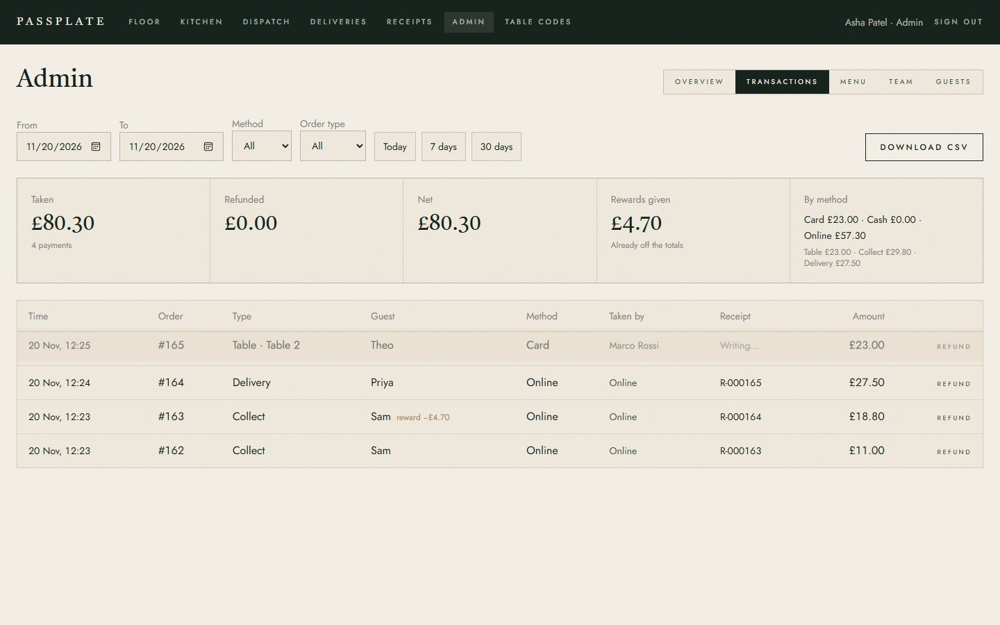
*Asha: Asha's transactions: the card payment arrives on its own*

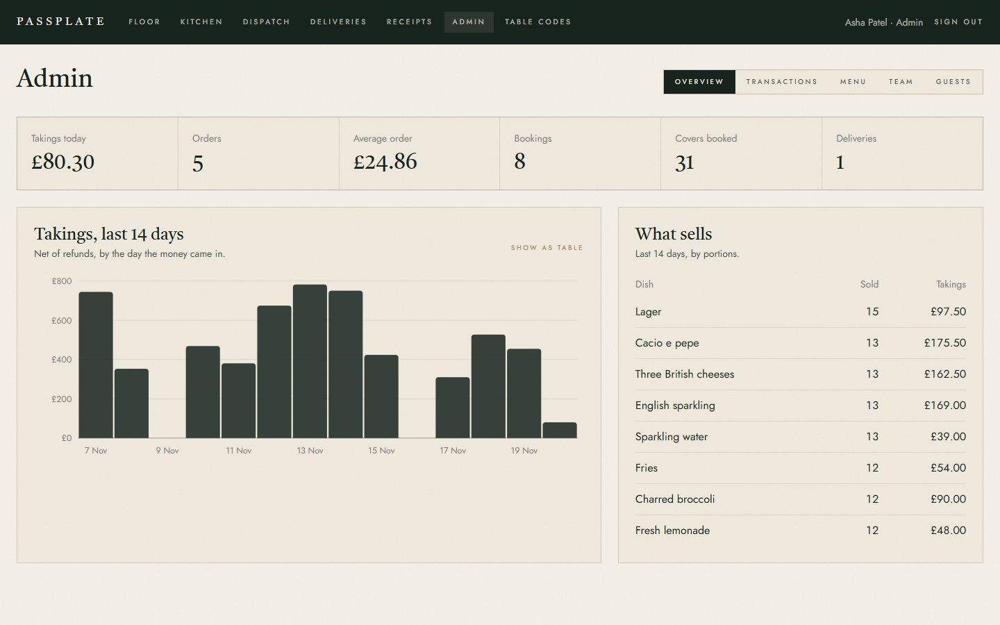
*Asha: Asha's overview*

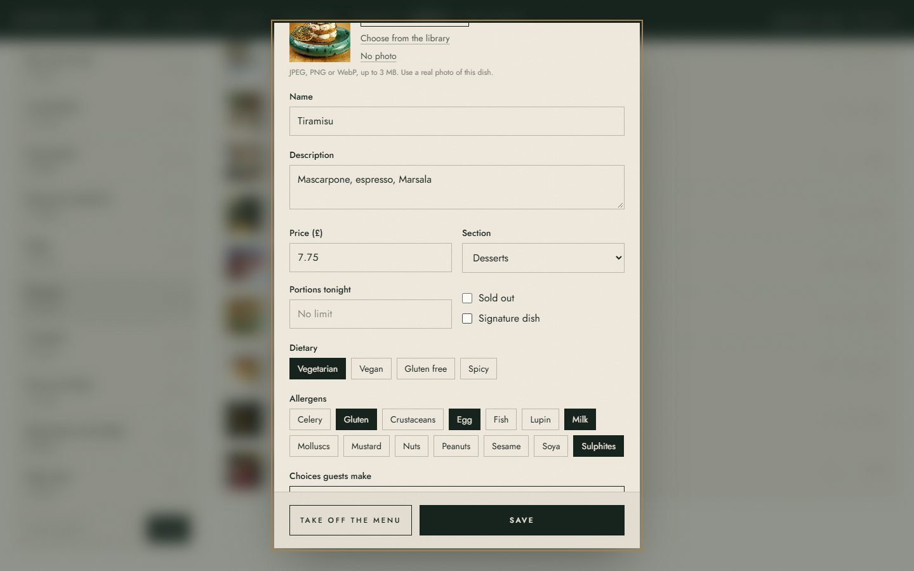
*Asha: Asha's menu editor: a dish with its photo, price, allergens and choices*
